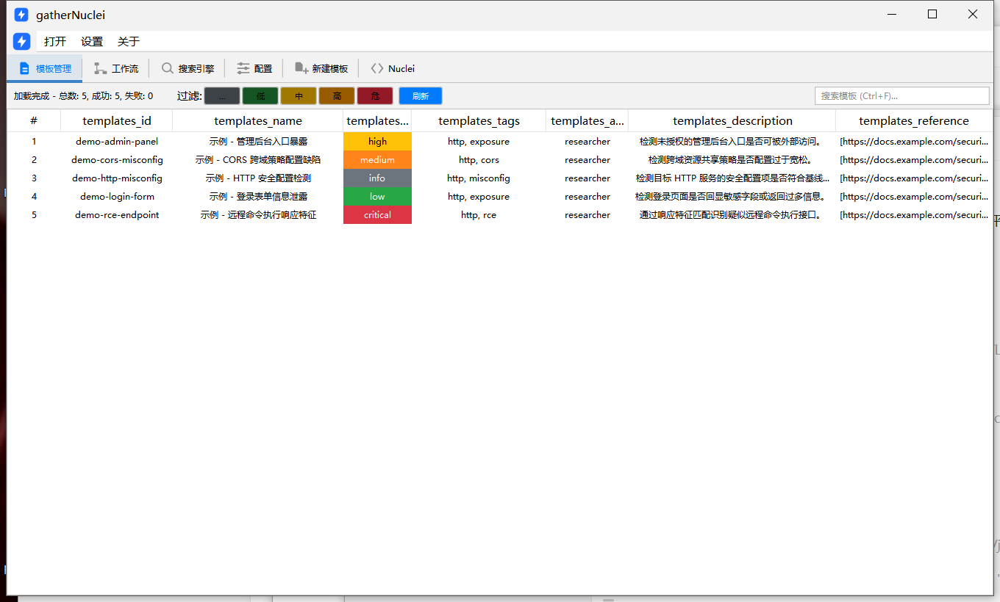
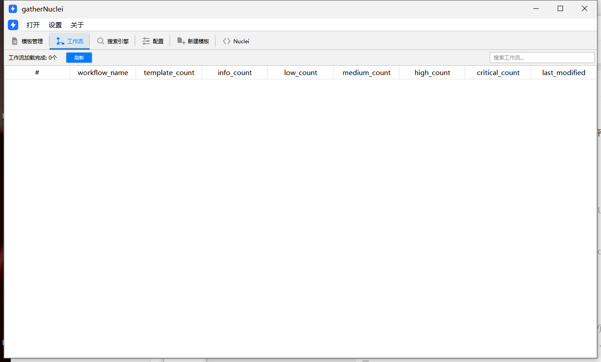
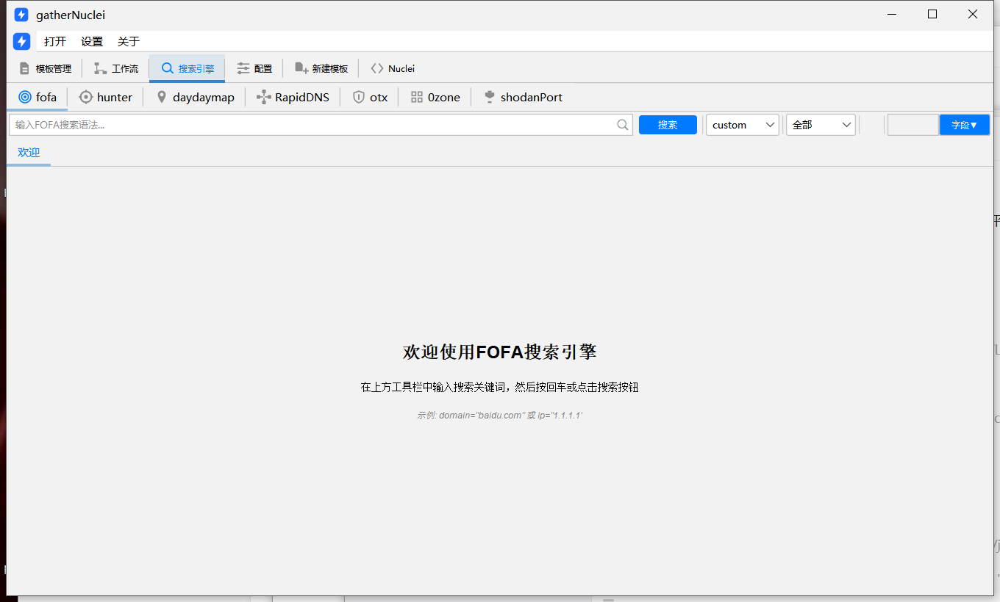
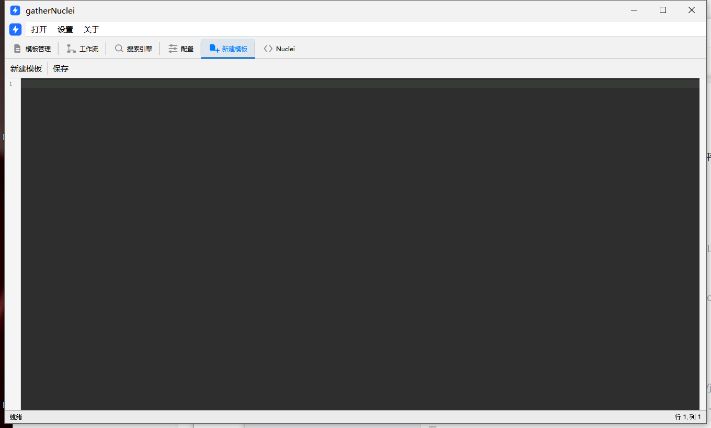
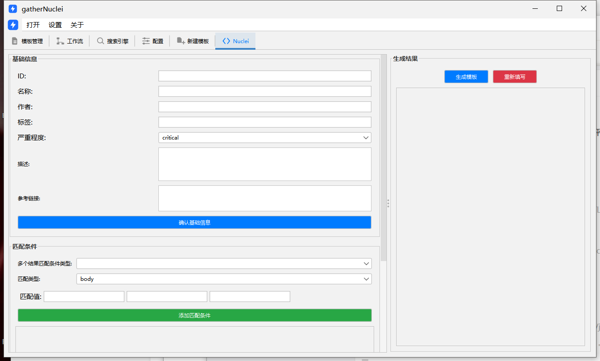
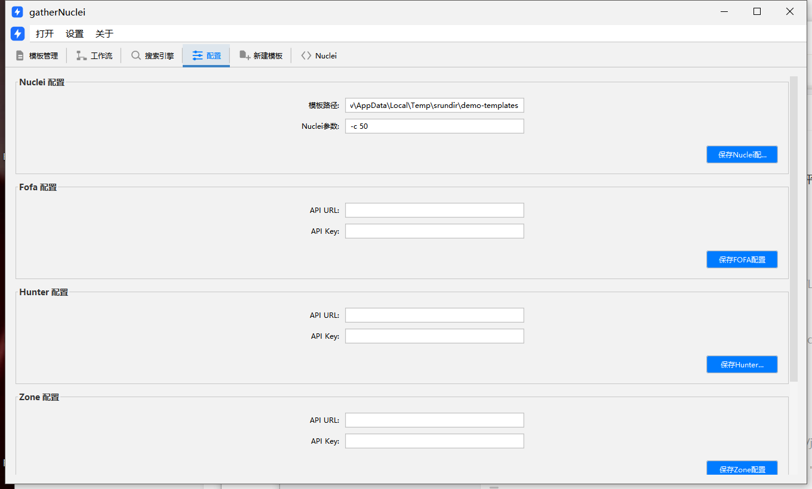

# gatherNuclei

> 集 Nuclei 模板管理与多空间测绘引擎搜索于一体的桌面工具

[](LICENSE)
[]()
[]()
[]()

一款基于 Java Swing 的网络安全研究辅助工具，把日常高频的 **Nuclei 模板管理**、**工作流编排** 与 **空间测绘引擎检索** 收敛到同一界面中，减少工具之间来回切换与结果手工整理的成本。



---

## 目录

- [核心能力](#核心能力)
- [功能模块](#功能模块)
- [快速开始](#快速开始)
- [使用说明](#使用说明)
- [配置说明](#配置说明)
- [项目结构](#项目结构)
- [安全声明](#安全声明)
- [开源协议](#开源协议)
- [贡献指南](#贡献指南)

---

## 核心能力

| 能力 | 说明 |
|------|------|
| 模板资产梳理 | 递归扫描本地模板目录，按 ID、名称、标签、作者、描述、引用与风险等级建表，支持关键词实时过滤与等级筛选 |
| 运行命令生成 | 选中的模板与工作流可直接生成可执行的 nuclei 命令并复制到剪贴板 |
| 工作流编排 | 把多个模板归入同一工作流，统一下发执行 |
| 空间资产检索 | 接入 7 个主流测绘与威胁情报引擎，提供一致的检索与结果浏览体验 |
| 模板创作 | 内置 YAML 编辑器与表单式模板生成器，两种方式产出 nuclei 模板 |
| 代理支持 | 全局 HTTP / SOCKS5 代理，所有引擎请求统一走代理配置 |

---

## 功能模块

### 1. 模板管理

扫描配置的模板目录，解析每个 `.yaml` 文件的 `info` 段并以表格呈现。风险等级列按 info / low / medium / high / critical 着色，异常文件会被单独归集，可在状态栏点击查看失败原因。


- **实时过滤**：关键词匹配 ID、名称、作者、描述与标签；等级按钮可独立开关
- **批量操作**：多选后可批量复制运行命令、删除或归入工作流
- **在线编辑**：双击即可在语法高亮编辑器中修改模板，支持 `Ctrl+S` 保存
- **运行命令**：一键生成 `nuclei -t <模板列表> <参数> -u` 并复制到剪贴板

### 2. 工作流管理

工作流以独立文件存放在程序目录的 `workflows/` 下，内部使用 nuclei 配置格式列出模板路径，可被 nuclei 的 `-config` 直接加载。



- **集中编排**：把相关模板组织到同一工作流，管理其风险等级构成
- **模板详情**：双击查看工作流内每个模板的完整元信息
- **一键下发**：复制 `nuclei -config <工作流文件> <参数> -u` 到剪贴板
- **自动刷新**：切换到该模块时自动同步磁盘上的最新工作流

### 3. 空间引擎搜索

统一封装 7 个引擎的检索能力，支持分页、字段自定义、结果复制与联动扫描。



| 引擎 | 用途 | 凭据要求 |
|------|------|----------|
| **fofa** | 网络空间测绘，支持按数据更新时间范围过滤 | API URL + API Key |
| **hunter** | 鹰图资产测绘，支持按资产类型与时间范围筛选 | API URL + API Key |
| **daydaymap** | 分布式侦察引擎 | API URL + API Key |
| **0zone** | 钟馗之眼，支持信息系统与移动应用两类检索 | API URL + API Key |
| **otx** | AlienVault OTX 威胁情报，按域名检索关联 URL | 无需凭据 |
| **RapidDNS** | 快速子域名枚举 | 无需凭据 |
| **shodanPort** | 基于 Shodan InternetDB 的端口与漏洞探测 | 无需凭据 |

- **结果处理**：多标签页并行浏览不同查询，分页切换、字段按需选择
- **结果操作**：整行复制、单独提取 IP 或 URL、浏览器直接打开
- **联动**：测绘结果中的 IP 可一键转入 shodan 模块做端口探测

### 4. 模板创作

**YAML 编辑器**支持语法高亮、代码折叠、括号匹配与行号显示，`Ctrl+N` 新建、`Ctrl+S` 保存至模板目录。



**表单式生成器**通过填写基础信息、匹配条件与原始 HTTP 请求，直接产出结构合法的模板。



- 基础信息：ID、名称、作者、标签、风险等级、描述与参考链接
- 匹配条件：状态码、关键字、正则、延时与外带交互，可组合多组
- HTTP 请求：原始报文编辑，Host 头自动替换为 `{{Hostname}}`

### 5. 配置中心

集中管理模板路径、nuclei 默认参数与各引擎凭据，保存后立即生效。



---

## 快速开始

### 环境要求

- JDK 8 或更高版本
- Maven 3.6+（仅构建时需要）
- 可选：已安装 nuclei 并加入 `PATH`

### 构建

```bash
git clone https://github.com/kN6jq/gatherNuclei.git
cd gatherNuclei
mvn clean package
```

构建产物位于 `target/gatherNuclei-v1.0.1-jar-with-dependencies.jar`。

### 运行

```bash
java -jar target/gatherNuclei-v1.0.1-jar-with-dependencies.jar
```

Windows 用户亦可直接双击 jar 文件启动。

### 首次配置

程序首次启动会在运行目录生成 `gatherConfig.yaml`，请在**配置**面板填入：

1. **模板路径**：本地 nuclei 模板目录（用于模板管理与工作流编排）
2. **Nuclei 参数**：命令中 `-u` 之前附加的默认参数，如 `-c 50 -severity high`
3. **各引擎凭据**：需要凭据的引擎填写其 API URL 与 API Key

---

## 使用说明

### 生成运行命令

| 场景 | 生成命令 |
|------|----------|
| 模板管理中选中若干模板 | `nuclei -t <模板1>,<模板2> <参数> -u` |
| 工作流模块选中工作流 | `nuclei -config <工作流文件> <参数> -u` |

命令复制后补上目标地址即可执行。

### 工作流文件格式

工作流位于程序目录的 `workflows/` 下，为 nuclei 配置文件格式：

```yaml
templates:
- /path/to/template-a.yaml
- /path/to/template-b.yaml
```

### 代理配置

在**设置 → 代理配置**中启用代理，支持 HTTP 与 SOCKS5，可填写认证信息。配置保存在 `proxy.properties`，所有引擎请求统一生效。

---

## 项目结构

```
gatherNuclei
├── pom.xml                      # Maven 构建配置
└── src/main
    ├── java/org/jiu
    │   ├── GatherNuclei.java     # 程序入口与主窗口
    │   ├── core/                 # 各引擎 API 封装
    │   ├── ui/                   # 界面模块
    │   │   ├── component/        # 图标与自定义组件
    │   │   ├── dialog/           # 代理配置对话框
    │   │   └── searchengine/     # 搜索引擎面板
    │   └── utils/                # 配置、HTTP、UI 工具
    └── resources/icons/          # 界面图标
```

---

## 安全声明

本工具仅用于安全研究与经授权的测试场景。

- 使用前请确保已获得目标资产方的明确授权
- 不得对未授权目标执行扫描或探测
- 工具生成的命令由使用者自行执行，行为与后果由使用者承担
- 请勿将包含真实凭据的配置文件提交至版本库

---

## 开源协议

本项目基于 [MIT](LICENSE) 协议开源。

---

## 贡献指南

- 欢迎通过 Issue 反馈使用问题或提出建议
- 欢迎提交 Pull Request 完善功能
- 提交代码前请确认本地配置与凭据文件未被纳入版本控制

---

## 项目地址

https://github.com/kN6jq/gatherNuclei
